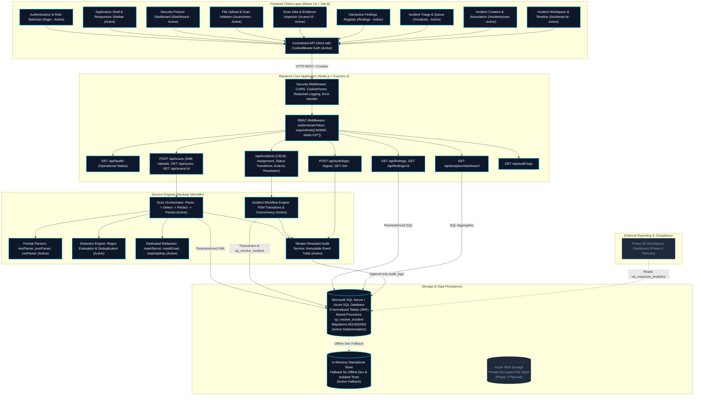

# LeakLens — System Architecture & Design Specification

**Platform Name:** LeakLens — Authorized Data Exposure Detection & Response  
**Current Phase:** Phase 3 Complete — Incident Response, Remediation & Verification Subsystem  
**Author:** Senior Full-Stack & Application Security Architect  

---

## 1. System Overview & Core Purpose

LeakLens is a defensive cybersecurity platform engineered to detect sensitive data exposures (API keys, asymmetric private keys, database credentials, authentication tokens, and personally identifiable information) in authorized files and repositories. It couples high-performance pattern matching and structural parsing with immediate evidence masking, role-based governance, incident response workflows, tamper-resistant audit logging, and security analytics.

---

## 2. Architectural Diagram

The diagram below maps the complete system boundary, highlighting components established through **Phase 1, Phase 2, and Phase 3 (Active Implementation)** versus **Phase 4 (Cloud Infrastructure & Advanced Analytics)**.



---

## 3. End-to-End Workflow: Finding to Atomic Resolution

```
1. FINDING DETECTED:
   File uploaded (.json, .txt, .csv) -> Scanner identifies sensitive secret (e.g. API key).
   Secret is redacted in memory (e.g. ghp_***_890) -> Finding saved to database as 'detected'.

2. INCIDENT ESCALATION:
   Analyst selects finding(s) in Findings Register -> clicks 'Escalate to Incident'.
   POST /api/incidents executed in atomic transaction:
     - Incident created with status = 'OPEN', version = 1.
     - Junction table leaklens.incident_findings linked.
     - Finding status updated to 'confirmed'.
     - Remediation action (STATUS_CHANGE) and audit log (INCIDENT_CREATED) recorded.

3. TRIAGE & ASSIGNMENT:
   Incident assigned to Lead Security Analyst.
   PATCH /api/incidents/:id/assignment executed:
     - Assigned_to updated, version incremented.
     - Remediation action (ASSIGNMENT) and audit log (INCIDENT_ASSIGNED) recorded.

4. INVESTIGATION & REMEDIATION:
   Status transitioned: OPEN -> IN_PROGRESS.
   Analyst records investigation notes and remediation actions (e.g. key rotation in cloud provider).
   POST /api/incidents/:id/actions executed with action_type = 'REMEDIATION'.

5. INDEPENDENT VERIFICATION:
   Analyst transitions incident to PENDING_VERIFICATION.
   Verification check conducted (e.g. validation that old key returns 403 Forbidden).
   POST /api/incidents/:id/verify recorded with outcome = 'PASSED'.

6. TRANSACTIONAL RESOLUTION:
   Analyst confirms resolution with resolution summary.
   Backend executes stored procedure leaklens.sp_resolve_incident within atomic transaction:
     - Status updated to RESOLVED, resolved_at set to UTC now, resolution_summary persisted.
     - All associated findings in leaklens.findings updated to 'remediated'.
     - Remediation action inserted with action_type = 'RESOLUTION'.
     - Security audit log inserted with event_type = 'INCIDENT_RESOLVED'.
     - Transaction committed atomically.
```
