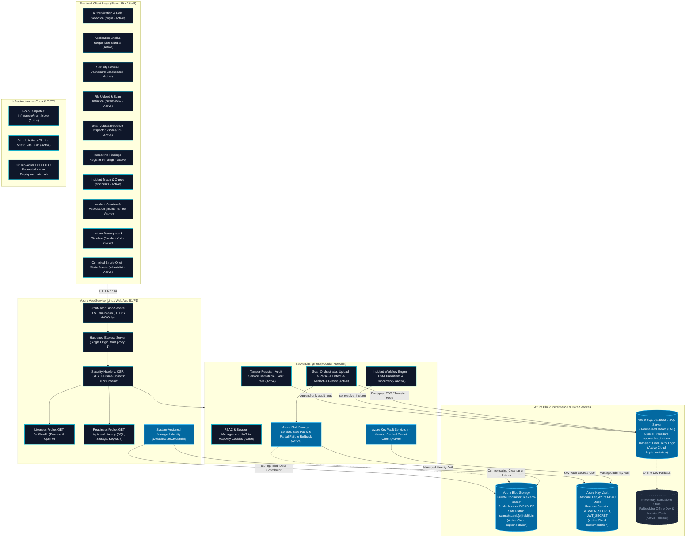

# LeakLens — System Architecture & Design Specification

**Platform Name:** LeakLens — Authorized Data Exposure Detection & Response  
**Current Phase:** Phase 4 Complete — Azure Integration, Cloud Security & Production Deployment  
**Author:** Senior Cloud Architect & Application Security Engineer  

---

## 1. System Overview & Core Purpose

LeakLens is a defensive cybersecurity platform engineered to detect sensitive data exposures (API keys, asymmetric private keys, database credentials, authentication tokens, and personally identifiable information) in authorized files and repositories. It couples high-performance pattern matching and structural parsing with immediate evidence masking, role-based governance, incident response workflows, tamper-resistant audit logging, cloud object storage, and security analytics.

Phase 4 establishes native **Microsoft Azure integration**, migrating the platform into a hardened, cloud-native architecture powered by Azure App Service, Azure SQL Database, Private Azure Blob Storage, Azure Key Vault, and System-Assigned Managed Identity.

---

## 2. Architectural Diagram

The diagram below maps the complete system boundary, highlighting components established through **Phase 1, 2, 3, and Phase 4 (Active Cloud Implementation)**.



---

## 3. End-to-End Cloud Workflow

```
1. INCOMING REQUEST & HOSTING:
   - External browser connects to Azure App Service over HTTPS (TLS 1.2+ enforced).
   - Express serves the compiled React single-page application from 'client/dist' on the same origin.
   - Cross-origin issues are eliminated, and strict CSP, HSTS, and X-Frame-Options headers are applied.

2. AUTHENTICATED SCAN INITIATION:
   - User uploads authorized file (.txt, .json, .csv) via POST /api/scans.
   - Multer memory storage validates MIME type, size (<10MB), and non-empty content.

3. DUAL-PHASE OBJECT STORAGE & SCANNING:
   - Scan orchestrator generates a non-reversible path: 'scans/{scan_id}/{file_id}.bin'.
   - File is uploaded to the private Azure Blob Storage container ('leaklens-scans') via Managed Identity.
   - Public access to the container is completely disabled.
   - The file content is parsed, scanned by detection rules, and sensitive excerpts are masked.

4. TRANSACTIONAL PERSISTENCE & CONSISTENCY:
   - Scan metadata, file record (including blob_path), and masked findings are persisted to Azure SQL.
   - If downstream parsing or database persistence fails, a compensating cleanup call (deleteBlob)
     immediately purges the uploaded blob, preventing orphaned storage objects.
   - Audit trail records scan creation, execution, and completion events.

5. INCIDENT MANAGEMENT & ATOMIC RESOLUTION:
   - Findings escalated to incidents undergo investigation, status transitions, and independent verification.
   - Atomic resolution invokes stored procedure leaklens.sp_resolve_incident, updating findings to 'remediated',
     recording resolution actions, and appending an immutable audit record in a single transaction.

6. SECRETS & CLOUD MONITORING:
   - Key Vault provides runtime secrets (SESSION_SECRET, JWT_SECRET) with zero credentials stored in Git.
   - Liveness probe (/api/health) and readiness probe (/api/health/ready) report operational dependency health
     without disclosing internal hostnames, credentials, or secrets.
```

---

## 4. Distinction Between Implemented & Planned Components

| Component | Status | Implementation Details |
| :--- | :--- | :--- |
| **Frontend SPA (React 19)** | **Active & Implemented** | Full component tree, state management, findings register, incident workspace, and timeline. |
| **Backend REST API (Express 4)** | **Active & Implemented** | Hardened single-origin server, RBAC middleware, 9 route modules, sanitized request logger. |
| **Azure SQL Persistence** | **Active & Implemented** | 9-table schema, view `vw_exposure_analytics`, stored procedure `sp_resolve_incident`, transient error retry. |
| **Private Azure Blob Storage** | **Active & Implemented** | Service provider `blobStorageService.js`, private container `leaklens-scans`, randomized blob paths, compensating cleanup. |
| **Azure Key Vault Integration** | **Active & Implemented** | In-memory cached secret client `keyVaultService.js` with `DefaultAzureCredential` and local fallback. |
| **Health & Readiness Endpoints** | **Active & Implemented** | `/api/health` (liveness) and `/api/health/ready` (readiness for SQL, Blob, and Key Vault). |
| **Infrastructure as Code (IaC)** | **Active & Implemented** | Bicep templates `infra/azure/main.bicep` and deployment scripts `deploy.ps1`, `deploy.sh`. |
| **CI/CD Automation** | **Active & Implemented** | GitHub Actions workflows `.github/workflows/ci.yml` and `deploy.yml` with OIDC authentication. |
| **Live Azure Resource Deployment** | **Configured / Unexecuted** | Local execution workstation lacks Azure CLI (`az`) and cloud credentials; assets validated locally. |
| **Power BI DirectQuery** | **Planned (Phase 5)** | Advanced compliance dashboards reading `vw_exposure_analytics`. |
