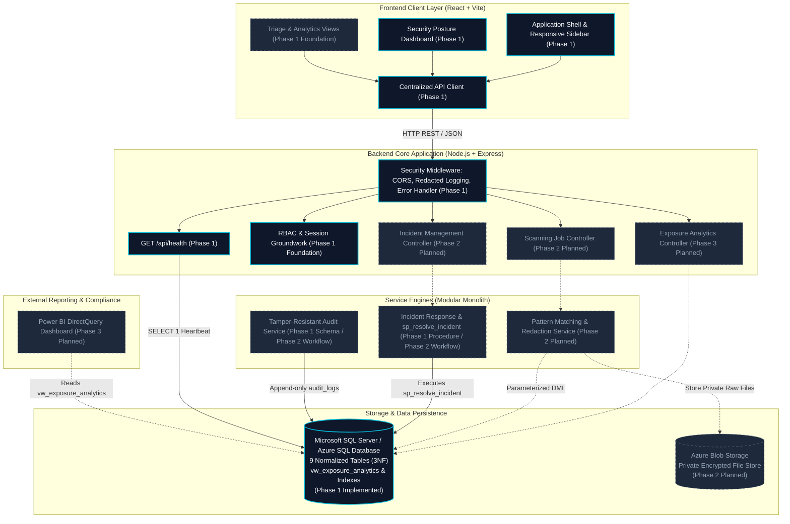

# LeakLens — System Architecture & Design Specification

**Platform Name:** LeakLens — Authorized Data Exposure Detection & Response  
**Current Phase:** Phase 1 Foundation & Database Architecture  
**Author:** Senior Full-Stack & Application Security Architect  

---

## 1. System Overview & Core Purpose

LeakLens is a defensive, authorized cybersecurity platform engineered to detect sensitive data exposures (API keys, asymmetric private keys, database credentials, authentication tokens, and personally identifiable information) in authorized files and repositories. It couples high-performance pattern matching and structural parsing with immediate evidence masking, incident escalation, tamper-resistant audit logging, and security analytics.

---

## 2. Architectural Diagram

The diagram below maps the complete system boundary, highlighting components established in **Phase 1 (Active Foundation)** versus upcoming **Phase 2 & 3 (Planned Components)**.

---

## 3. Requirements Analysis

### 3.1 Functional Requirements
1. **Authorized Ingestion & Deduplication:** Ingest user-submitted files and directories with SHA-256 content hashing to eliminate redundant inspection cycles.
2. **Defensive Exposure Detection:** Inspect file contents against defined pattern signatures (AWS keys, GitHub tokens, database connection strings, JWT secrets).
3. **Evidence Masking:** Cryptographically redact detected secrets before database persistence (e.g. `AKIA****************`). Raw plaintext secrets must never enter relational tables or client responses.
4. **Security Incident Management:** Group related findings into trackable incidents, assign security analysts, and orchestrate remediation actions (key rotation, revocation).
5. **Tamper-Resistant Audit Logging:** Record non-repudiable logs of all security actions, role changes, and resolution workflows with validated JSON context.
6. **Executive Reporting:** Provide SQL views (`vw_exposure_analytics`) for operational dashboards and Power BI reporting without count duplication anomalies.

### 3.2 Non-Functional Requirements
1. **Confidentiality & Least Privilege:** Plaintext credentials and secrets are excluded from logs, error payloads, and source code. Database connections use dedicated least-privilege service accounts.
2. **Resilience & Graceful Degradation:** The backend continues operating with clear `degraded` health status if database connectivity is temporarily lost.
3. **Data Integrity & Third Normal Form (3NF):** High database normalization ensures zero update anomalies and prevents phantom row multiplication across many-to-many joins.
4. **Transport Layer Security (TLS):** All external and database communications enforce TLS encryption (`encrypt: true`). In production, self-signed certificates are explicitly prohibited (`trustServerCertificate: false`).

---

## 4. Key Architectural Boundaries

### 4.1 Frontend / Backend Separation
- The React + Vite client is an independent Single Page Application (SPA).
- Communicates with the Express backend exclusively through a versioned REST API (`/api/*`).
- No direct database drivers, secrets, or elevated credentials exist within client bundles.

### 4.2 Modular Monolith vs. Microservices (Design Trade-Off)
- **Decision:** LeakLens is intentionally structured as a **Modular Monolith** for Phase 1 and the initial release, rather than a distributed microservices cluster.
- **Rationale & Viva Justification:**
  - *Operational Simplicity:* A modular monolith eliminates the distributed systems overhead of service discovery, network partition latency, distributed transactions (two-phase commits), and complex container orchestration.
  - *Transaction Integrity:* Incident resolution with simultaneous remediation action recording and audit trail logging can execute as an atomic ACID transaction within SQL Server via `sp_resolve_incident`.
  - *Future Extensibility:* Business domains (`scanner`, `incidents`, `audit`) are strictly separated into discrete service folders (`server/src/services/*`). If scanning throughput demands high horizontal scaling later, the `scanner` service can be decoupled into an asynchronous serverless worker (Azure Function or containerized worker) with minimal refactoring.

### 4.3 Storage Responsibilities
- **Microsoft SQL Server / Azure SQL Database:** Handles all relational entities, normalized metadata, finding references, incident states, RBAC identities, and immutable audit logs.
- **Azure Blob Storage (Phase 2):** Stores raw files in private, encrypted blob containers. Access is gated via short-lived Shared Access Signature (SAS) tokens generated by the backend API.

### 4.4 Authentication and Authorization (RBAC)
- RBAC is enforced strictly on the backend.
- Role tiers supported:
  - `admin`: Full system management, rule customization, and user provisioning.
  - `security_analyst`: Scan initiation, finding triage, incident containment, and remediation.
  - `auditor`: Read-only access to audit logs, scan histories, and compliance metrics.
  - `viewer`: Read-only visibility to aggregated executive dashboards.
