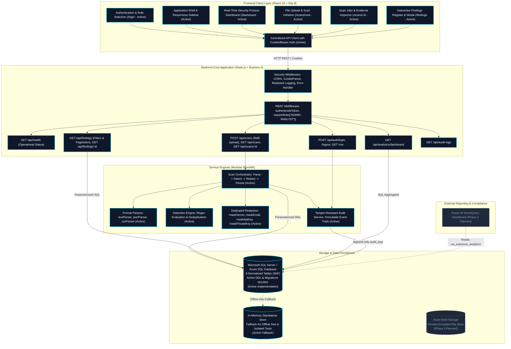

# LeakLens — System Architecture & Design Specification

**Platform Name:** LeakLens — Authorized Data Exposure Detection & Response  
**Current Phase:** Phase 2 Complete — Authentication, Ingestion, Detection Engine & Findings Dashboard  
**Author:** Senior Full-Stack & Application Security Architect  

---

## 1. System Overview & Core Purpose

LeakLens is a defensive cybersecurity platform engineered to detect sensitive data exposures (API keys, asymmetric private keys, database credentials, authentication tokens, and personally identifiable information) in authorized files and repositories. It couples high-performance pattern matching and structural parsing with immediate evidence masking, role-based governance, tamper-resistant audit logging, and security analytics.

---

## 2. Architectural Diagram

The diagram below maps the complete system boundary, highlighting components established in **Phase 1 & Phase 2 (Active Implementation)** versus upcoming **Phase 3 (Planned Components)**.

---

## 3. Implemented End-to-End Workflow

1. **Authentication:** The user logs in at `/login` with provisioned credentials. Password verification executes via `bcrypt.compare`. An 8-hour HttpOnly session cookie (`leaklens_token`) and JWT token are issued.
2. **Role Verification:** When navigating or initiating an upload, `requireRole` verifies authorization:
   - `ADMIN` & `ANALYST`: Authorized to trigger file scans.
   - `COMPLIANCE_REVIEWER`: Authorized for read-only viewing; scan initiation is blocked with HTTP 403 Forbidden.
3. **File Validation:** The upload handler validates extensions (`.txt`, `.json`, `.csv`), enforces 5MB limits, checks for null-byte binary headers, and maps content to locational coordinates.
4. **Detection & Redaction:** Active rules (`EMAIL_ADDRESS`, `API_KEY_CANDIDATE`, `PRIVATE_KEY_MARKER`, `SENSITIVE_IDENTIFIER`) are evaluated. Matched values are immediately masked in memory by `maskingService`.
5. **Relational Persistence:**
   - A `scan_jobs` record is created.
   - A `files` record is created with SHA-256 hash.
   - A batch of masked `findings` is inserted with foreign keys.
   - The scan job is updated to `completed`.
   - Immutable records are appended to `audit_logs`.
6. **Findings Dashboard:** The client renders real aggregate metrics, filterable finding registers, and detailed evidence views.
