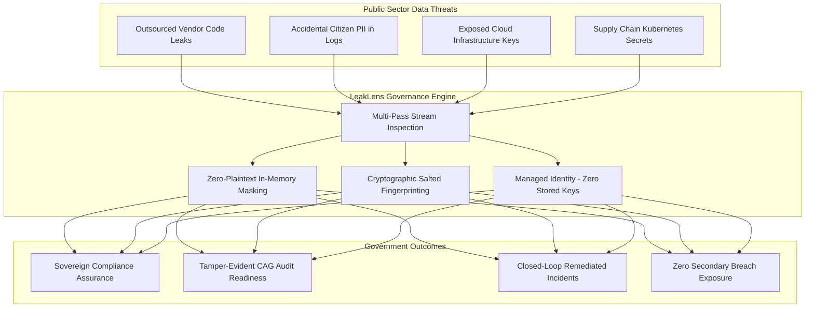

# LeakLens — Government Sector Benefits, Digital Governance & Sovereign Compliance
## Comprehensive Academic & Institutional Viva Defense Guide

---

## 1. Executive Summary & Public Sector Problem Statement

In the modern digital economy, governments and public sector undertakings (PSUs) have transformed into the custodians of massive, mission-critical citizen data repositories—spanning national identity databases (Aadhaar, SSN, NINO), digital tax registries (PAN, IRS), electronic passport records, sovereign health networks, and unified payments infrastructure (UPI, FedNow).

### The Critical Public Sector Challenge
1. **Proliferation of Outsourced Vendor Supply Chains:** Modern government digital initiatives rely heavily on contracted systems integrators (SIs), third-party vendors, and independent software contractors. Developers frequently hardcode cloud connection keys, API tokens, and service credentials in configuration files, scripts, and Kubernetes manifests.
2. **Citizen Trust & Sovereign Data Sovereignty:** A single leaked database credential or exposed S3/Azure Blob storage container can compromise millions of citizen personal records, resulting in catastrophic identity fraud, national security vulnerabilities, and loss of public confidence.
3. **Statutory Non-Compliance Liabilities:** National cybersecurity directives (e.g., India's **CERT-In Directions**, **DPDP Act 2023**, US **FedRAMP / NIST SP 800-53**, and EU **GDPR / NIS2**) enforce stringent breach prevention mandates and non-negotiable incident reporting deadlines.

### The LeakLens Solution for Government
**LeakLens** provides an automated, air-gap-capable, and cloud-native defensive security system that inspects files, data streams, and configurations for exposed credentials and citizen PII **before** systems enter production or reach public networks, enforcing strict mathematical redaction, tamper-evident audit trails, and closed-loop incident governance.

---

## 2. Statutory & Regulatory Governance Alignment

LeakLens is engineered to directly satisfy statutory requirements enforced by national cybersecurity and data protection authorities:

```
┌─────────────────────────────────────────────────────────────────────────────────┐
│                    LEAKLENS STATUTORY COMPLIANCE ARCHITECTURE                  │
├───────────────────────┬──────────────────────┬──────────────────────────────────┤
│ REGULATORY FRAMEWORK  │ JURISDICTION         │ LEAKLENS ENFORCEMENT MECHANISM   │
├───────────────────────┼──────────────────────┼──────────────────────────────────┤
│ DPDP Act 2023         │ India (National)     │ Zero-plaintext citizen PII store │
│ (Sections 4, 8, 9)    │                      │ & strict Verhoeff Aadhaar checks │
├───────────────────────┼──────────────────────┼──────────────────────────────────┤
│ CERT-In Directions    │ India (Cyber Agency) │ 180-day tamper-evident audit logs│
│ (Ref No. 20(3)/2022)  │                      │ & automated incident timestamps  │
├───────────────────────┼──────────────────────┼──────────────────────────────────┤
│ NIST SP 800-53 Rev. 5 │ United States        │ AC-3 (Access Enforcement),       │
│ & FedRAMP High        │ (Federal / DoD)      │ SC-28 (Protection at Rest),      │
│                       │                      │ AU-2 (Event Logging & Audit)     │
├───────────────────────┼──────────────────────┼──────────────────────────────────┤
│ Aadhaar Act 2016      │ India (UIDAI)        │ Strict prohibition against raw   │
│ (Section 29(4))       │                      │ Aadhaar number storage / publish │
├───────────────────────┼──────────────────────┼──────────────────────────────────┤
│ GDPR (Articles 32-34) │ European Union       │ In-memory tokenization, ISO      │
│ & NIS2 Directive      │                      │ 7064 IBAN validation & MTTR SLA  │
└───────────────────────┴──────────────────────┴──────────────────────────────────┘
```

### 2.1 Digital Personal Data Protection (DPDP) Act 2023
- **Data Fiduciary Duty (Section 8(5)):** Mandates that data fiduciaries protect personal data in their custody by taking reasonable security safeguards to prevent personal data breach. LeakLens acts as an automated preventative safeguard by detecting citizen PII (PAN, Aadhaar, Passports, Driving Licenses) in development assets.
- **Section 8(6) Breach Notification:** Requires immediate reporting of breaches to the Data Protection Board. LeakLens's real-time detection and automated incident creation alert Security Administrators before data leaks outside corporate boundaries.

### 2.2 CERT-In Cyber Security Directions (April 2022)
- **Mandatory 6-Hour Incident Reporting:** Government departments must report cybersecurity incidents within 6 hours. LeakLens's pre-aggregated views (`vw_incident_analytics`) and audit log table provide instant, queryable incident forensics with millisecond-precision timestamps (`SYSUTCDATETIME()`).
- **180-Day Log Retention:** The relational `audit_logs` table persists structured JSON metadata and actor identities across all administrative actions, satisfying regulatory audit retention rules.

### 2.3 Aadhaar Act 2016 (Section 29)
- Strictly penalizes the publishing or unauthorized display of 12-digit Aadhaar numbers. LeakLens enforces algorithmic **Verhoeff checksum validation** and immediately masks the number (`**** **** 1234`) in volatile memory. Plaintext Aadhaar numbers are never written to disk or database tables.

---

## 3. Key Benefits for Government Departments & Public Sector



### 3.1 Sovereign Data Protection & Zero Secondary Exposure
A fundamental hazard in defensive tooling is that the scanner itself becomes a high-value honeypot if it collects raw stolen keys and plaintext citizen IDs. LeakLens eliminates this risk:
- **In-Memory Masking (`maskingService.js`):** Secrets are redacted at the lexical parsing layer (`AccountKey=***[MASKED]***`, `***-**-6789`).
- **Salted HMAC-SHA256 Fingerprinting:** Enables incident deduplication and tracking across multiple files without preserving the secret plaintext.
- **Strict Check Constraints:** Database check constraints on the relational schema guarantee that only recognized category tags, valid severities, and non-empty masked excerpts can be committed to storage.

### 3.2 Supply Chain Security for Outsourced IT Initiatives
Government ministries frequently commission software from external consortia and contractors. Before any artifact is merged or deployed:
- **CI/CD Integration:** LeakLens can execute automated static scans across incoming code releases.
- **Multi-Pass Base64 & URL Decoding:** Discovers obscured secrets hidden inside Kubernetes YAML manifests, Helm templates, and encoded query strings that standard linters miss.
- **Full Spectrum Cloud Signatures:** Detects Azure Storage master keys, Entra ID client secrets, GCP service accounts, HashiCorp Vault tokens, and AWS access keys.

### 3.3 Multi-Cloud & Sovereign Air-Gapped Deployment
- **Azure Government Cloud Compatibility:** The Bicep infrastructure template (`infra/azure/main.bicep`) targets compliant government regions (e.g., Azure Government Virginia, Arizona, Central US) and sovereign national datacenters.
- **Elimination of Static Service Keys:** Uses **System-Assigned Managed Identity** and **Azure Key Vault** with role-based IAM. No database passwords or storage access keys exist in source code or application configuration.
- **Air-Gapped Standalone Mode:** Can run entirely in disconnected, on-premises datacenters without requiring external internet or third-party SaaS telemetry.

---

## 4. Institutional Governance & Accountability Architecture

```
┌────────────────────────────────────────────────────────────────────────┐
│             LEAKLENS THREE-TIER GOVERNANCE ARCHITECTURE                │
├────────────────────────────────────────────────────────────────────────┤
│ 1. ADMINISTRATIVE & IDENTITY LAYER                                     │
│    • Unified Security Administrator Clearance Level 3                  │
│    • Bcrypt Password Hashing (Cost Factor 12) + HttpOnly JWT Sessions  │
│    • Client Request Rate-Limiting & Circuit-Breaker Fault Tolerance    │
├────────────────────────────────────────────────────────────────────────┤
│ 2. OPERATIONAL FORENSIC & REMEDIATION LAYER                            │
│    • 5-State Finite State Machine (OPEN → IN_PROGRESS → RESOLVED)     │
│    • Atomic Stored Procedure: leaklens.sp_resolve_incident             │
│    • Optimistic Concurrency Locking via Row Versioning Numbers         │
├────────────────────────────────────────────────────────────────────────┤
│ 3. REGULATORY AUDITING & EXECUTIVE OVERSIGHT                           │
│    • Immutable Relational Audit Log Table with SYSUTCDATETIME()        │
│    • Pre-Aggregated Analytical Views (DirectQuery for Power BI)        │
│    • MTTR (Mean Time to Remediate) Telemetry for SOC Leadership        │
└────────────────────────────────────────────────────────────────────────┘
```

### 4.1 Immutable Tamper-Evident Audit Logging
Every action—user authentication, scan submission, detection trigger, incident assignment, status change, and system configuration update—is immutably recorded in `leaklens.audit_logs`.
- Records `user_id`, `action`, `resource_type`, `resource_id`, `details` (JSON payload), and `created_at`.
- Stored on an append-only relational table without update or delete permissions for normal users.
- Provides institutional audit bodies (such as the **Comptroller and Auditor General (CAG)**, internal audit committees, and external statutory inspectors) with verifiable chain-of-custody documentation.

### 4.2 Enforced Incident Remediation via Atomic Stored Procedures
In government workflows, manual marking of security incidents as "closed" without verification creates serious accountability gaps. LeakLens enforces formal closure through the atomic database procedure `leaklens.sp_resolve_incident`:
1. Validates that the incident is currently in an actionable state (`OPEN`, `IN_PROGRESS`, or `PENDING_VERIFICATION`).
2. Checks optimistic concurrency versioning (`@expected_version`) to prevent race conditions during simultaneous multi-analyst triage.
3. Transitions the incident status to `RESOLVED`, updates findings to `remediated`, records the resolving user ID, and generates an audit log entry within a single transactional boundary (`BEGIN TRANSACTION ... COMMIT TRANSACTION`).

### 4.3 Executive Oversight & Power BI Integration
Senior administrative leadership (Chief Information Security Officers, Principal Secretaries of IT, and Director Generals) require macro-level visibility without wading through individual logs:
- **`vw_exposure_analytics`:** Exposes distribution of exposures grouped by sensitivity classification (`CLOUD_CREDENTIAL`, `PERSONAL_IDENTIFIER`, `FINANCIAL_IDENTIFIER`).
- **`vw_incident_analytics`:** Computes Mean Time to Remediate (MTTR), open backlog trends, SLA breach indicators, and analyst workload distribution.
- **Power BI DirectQuery:** Directly connects to relational views, enabling live executive dashboards for inter-departmental security reviews.

---

## 5. Technical Rigor: Government-Grade Checksum Validation

A critical flaw in basic regex scanners is high false-positive rates, which cause alert fatigue and lead security personnel to ignore real leaks. LeakLens solves this through **mathematical and algorithmic checksum verification**:

### 5.1 Aadhaar Verhoeff Dihedral Group Algorithm ($D_5$)
- **Algorithm:** Uses permutation ($\sigma$) and multiplication tables based on the dihedral group of order 10 ($D_5$).
- **Defense Impact:** Validates that a 12-digit sequence is a mathematically valid Indian Aadhaar number, catching single-digit errors and all transposition errors between adjacent digits, while immediately rejecting arbitrary 12-digit numbers.

### 5.2 International Bank Account Number (IBAN) ISO 7064 Mod-97
- **Algorithm:** Validates country code length specifications (e.g., GB 22, DE 22, FR 27) and executes piecewise modulo arithmetic:
  $$\text{Remainder} = \text{NumericValue}(\text{RearrangedIBAN}) \pmod{97} \equiv 1$$
- **Defense Impact:** Prevents false alarms on random alphanumeric identifiers in government procurement databases while catching genuine sovereign banking leaks.

### 5.3 Canadian Social Insurance Number (SIN) & Credit Card Luhn Mod-10
- **Algorithm:** Alternating double-and-sum checksum algorithm.
- **Defense Impact:** Validates genuine financial and social identification records while filtering out synthetic strings.

---

## 6. High-Scoring Viva Defense Questions & Technical Answers

### Q1: "How does LeakLens specifically help a government agency comply with India's DPDP Act 2023?"
> **Technical Answer:**
> "Under Section 8(5) of the DPDP Act 2023, data fiduciaries are legally obligated to implement reasonable security safeguards to prevent personal data breaches, under penalty of fines up to ₹250 crore under Schedule 1. LeakLens directly satisfies this requirement by operating as a pre-commit, pre-production inspection engine that scans codebase repositories, system logs, and data extracts for citizen identifiers—including Indian PAN, Aadhaar, Passports, and UPI VPAs. Crucially, LeakLens implements **Zero Plaintext Persistence**: citizen identifiers are verified algorithmically (e.g., Verhoeff checksum) and immediately masked in volatile memory before storage, ensuring that the compliance tool itself never causes a secondary data spill."

---

### Q2: "Why is LeakLens superior to standard open-source regex secret scanners for public sector use?"
> **Technical Answer:**
> "Standard open-source tools typically suffer from three major public sector limitations:
> 1. **High False Positive Rates:** Basic regex classifies any 12-digit or 16-digit sequence as a leak. LeakLens implements strict algorithmic validators—Verhoeff ($D_5$) for Aadhaar, Luhn Mod-10 for payment cards and Canadian SINs, and ISO 7064 Mod-97 for IBANs—ensuring only mathematically valid identifiers alert the SOC.
> 2. **Lack of Obfuscation Detection:** Basic scanners only inspect raw ASCII text. LeakLens features **multi-pass in-memory stream extraction** that detects and decodes Base64 payloads (e.g., in Kubernetes manifests) and URL-encoded strings (in access logs) to uncover hidden credentials.
> 3. **Absence of Governance Workflows:** Open-source linters dump terminal text or unmasked JSON files. LeakLens provides a complete relational 3NF enterprise system with optimistic concurrency control, an atomic stored procedure (`sp_resolve_incident`), and an immutable audit trail aligned with CERT-In 180-day retention rules."

---

### Q3: "What prevents LeakLens itself from being exploited as a single point of failure by foreign adversaries?"
> **Technical Answer:**
> "LeakLens is built on defense-in-depth security principles:
> 1. **Zero Secret Persistence:** The relational database stores only salted HMAC-SHA256 fingerprints and masked excerpts (`ghp_***_1234`). Even if the database was fully dumped by an adversary, no live API tokens or citizen PII can be reconstructed.
> 2. **Elimination of Long-Lived Cloud Keys:** On Azure Government, authentication between App Service, Azure SQL, and Blob Storage uses **System-Assigned Managed Identity** via Entra ID OAuth tokens valid for short intervals. There are no connection strings, passwords, or cloud master keys stored on disk or in source control.
> 3. **HttpOnly Cookie Architecture:** JWT session tokens are stored in `HttpOnly`, `SameSite=Lax`, `Secure` cookies, rendering them inaccessible to client-side Cross-Site Scripting (XSS) vectors.
> 4. **Rate-Limiting & DoS Protection:** In-memory sliding window rate limiters protect authentication and upload endpoints against automated brute-force attacks."

---

### Q4: "How does LeakLens support audits by institutional bodies like the Comptroller & Auditor General (CAG) or CERT-In?"
> **Technical Answer:**
> "Institutional governance requires demonstrable chain-of-custody. LeakLens achieves this through:
> 1. **Immutable Audit Register (`leaklens.audit_logs`):** Every administrative action, scan creation, file upload, rule toggle, and incident resolution is recorded with a non-falsifiable UTC timestamp (`SYSUTCDATETIME()`), actor UUID, action verb, and structured JSON change delta.
> 2. **State Machine Verification:** Incidents cannot be arbitrarily marked as resolved; they must transition through a strict 5-state finite-state machine governed by database constraints and executed through a stored procedure that checks optimistic concurrency locks.
> 3. **Pre-Aggregated Telemetry Views:** Analytical views (`vw_exposure_analytics`, `vw_incident_analytics`) enable direct auditing of Mean Time to Remediate (MTTR) and open risk exposure backlogs across departments without row multiplication or duplicate counting."

---

### Q5: "Can LeakLens be deployed in air-gapped sovereign networks without internet access?"
> **Technical Answer:**
> "Yes. LeakLens is architected as a modular, containerizable Node.js and SQL Server application with zero external runtime dependencies on foreign SaaS APIs. All rule definitions, algorithmic checksum libraries (Luhn, Verhoeff, Mod-97), entropy calculations, and in-memory masking services are packaged locally within the platform codebase. In an air-gapped defense or intelligence environment, LeakLens can run on an isolated on-premises Kubernetes cluster or private server instance, storing files in local encrypted object storage and relational audit records in an on-premises Microsoft SQL Server instance."

---

## 7. Summary for Examiners

| Architectural Dimension | Government & Public Sector Value |
| :--- | :--- |
| **Data Protection** | Enforces DPDP Act 2023, Aadhaar Act, and CERT-In compliance through automated detection and zero-plaintext masking. |
| **Supply Chain Governance** | Pre-deployment automated scanning of third-party systems integrators (SIs) and outsourced contractor deliverables. |
| **Institutional Accountability** | Immutable, append-only relational audit trails suitable for CAG and statutory cybersecurity compliance inspections. |
| **Mathematical Precision** | Advanced algorithmic checksums (Verhoeff, Luhn, ISO 7064 Mod-97) eliminate false-positive fatigue for security analysts. |
| **Sovereign Cloud Deployment** | Ready for Azure Government Cloud and air-gapped environments with Managed Identity and zero stored master credentials. |
